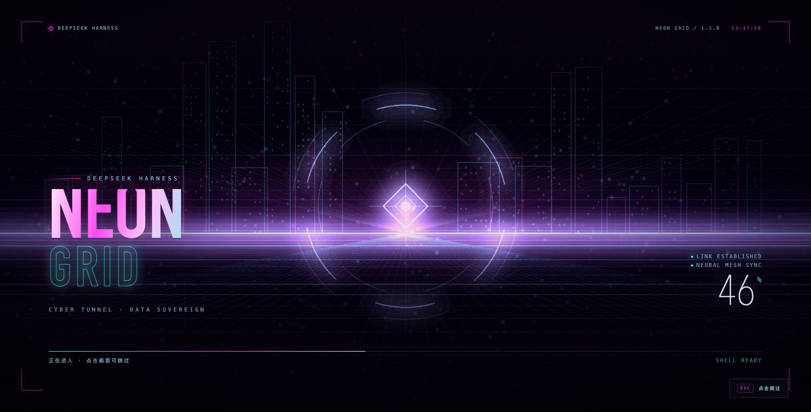
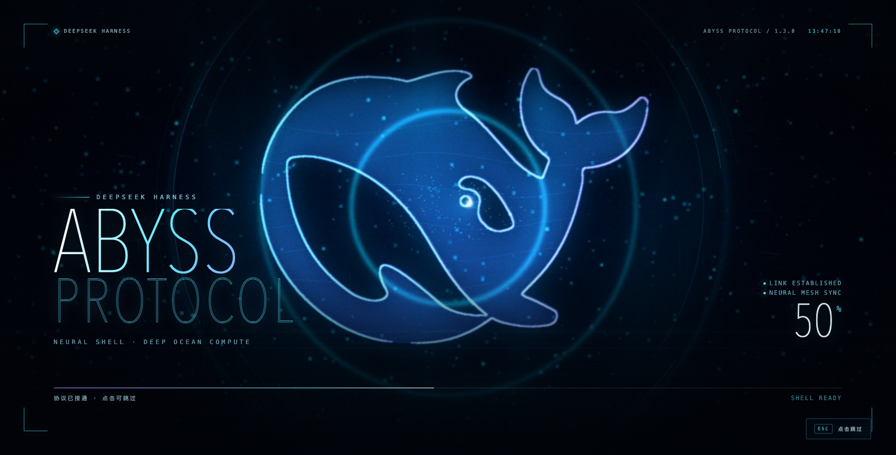
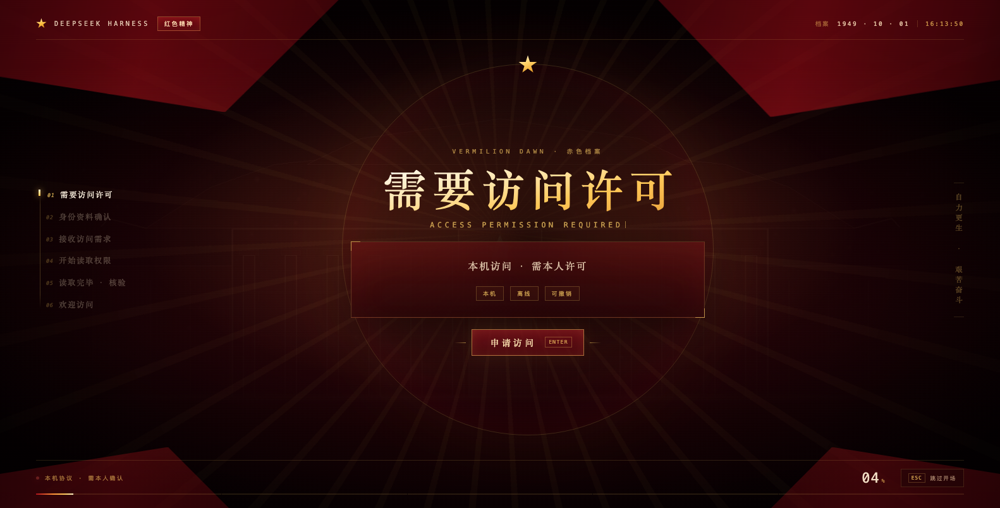
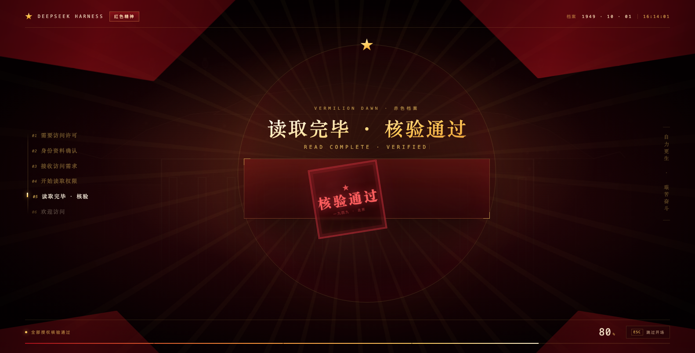
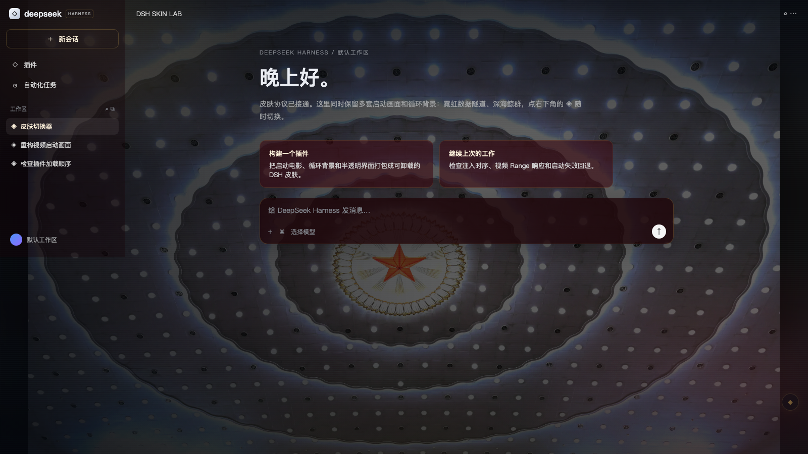
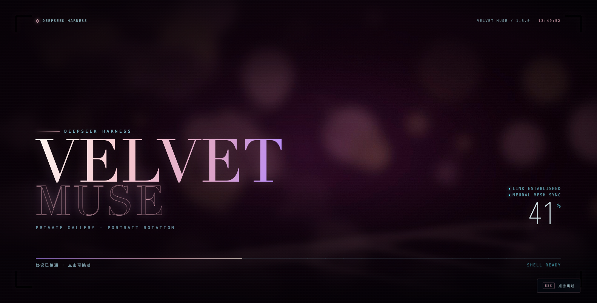
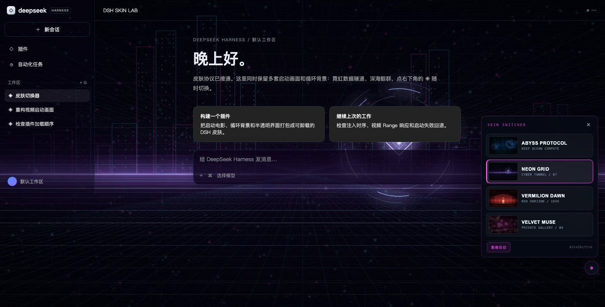
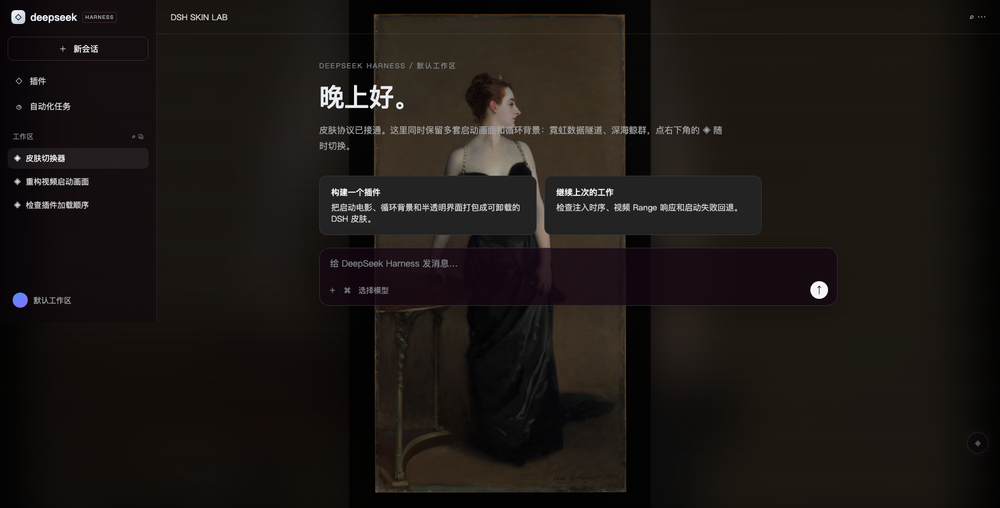

# dsh-abyss-skin · 多套科技皮肤

给 **DeepSeek Harness** 的一套可切换启动画面 + 背景皮肤包：大多数皮肤启动时播放全屏有声短片，进入后铺循环背景；VERMILION DAWN 用六幕交互仪式，背景支持视频或静态图。右下角切换器可以**同时保留多套皮肤、即时换背景、重播启动画面**。

当前内置四套：

| 皮肤 | 风格 | 启动片 | 背景 |
| --- | --- | --- | --- |
| **NEON GRID**（默认） | 霓虹矩阵 / 数据隧道 / 品红脉冲 | 8s 有声 | 12s 循环 |
| **ABYSS PROTOCOL** | 深海 / 全息鲸群 / 青紫冷光 | 10s 有声 | 12s 循环 |
| **VERMILION DAWN** | 红色精神 / 人民殿堂 / 五星礼花 | 六幕交互仪式（约 20s，无启动片） | 静态图 `poster.jpg` |
| **VELVET MUSE** | 私人画廊 / 多图轮换 / 玫瑰金 | 8s 占位启动 | 多图轮换 |















> MUSE 默认只带玫瑰金抽象占位图；把你有权使用的 4–8 张图放进 `skins/muse/images/`，运行 `python3 tools/render_muse.py`，重启后才会显示真人像。下面这张是“放入图片后”的画廊构图示意（示例使用公版油画，不是内置素材）：



> VERMILION DAWN 是程序化的红金殿堂场景：柱廊、金色五角星、红灯笼、红绸与礼花，不包含真实人物影像。启动改为六幕交互式「赤色档案」仪式，**不加载 boot.mp4，也没有进行曲音轨**；声音来自 `skins/vermilion/lib/assets` 的六句台词与界面音效，不使用历史录音或《欢迎进行曲》原曲。

## 项目路径

```text
/Users/liuzuodong/Documents/deepseek-harness/default-workspace/dsh-abyss-skin
```

关键文件：

| 路径 | 作用 |
| --- | --- |
| [index.js](index.js) | 宿主：皮肤发现、注入、媒体 Range 路由（视频/图片）、active 持久化 |
| [runtime/skin.js](runtime/skin.js) | 启动时序、六幕仪式、音频引擎（台词/音效）、视频/静态图背景挂载、皮肤切换器 |
| [runtime/skin.css](runtime/skin.css) | 启动 HUD、背景、界面色板、切换器 |
| [skins/abyss/](skins/abyss/) | ABYSS 皮肤包（`skin.json` + 两段视频 + 海报） |
| [skins/neon/](skins/neon/) | NEON GRID 皮肤包 |
| [skins/vermilion/](skins/vermilion/) | VERMILION DAWN 皮肤包（静态图背景 + 六幕仪式） |
| [skins/vermilion/AUDIO-FIELDS.md](skins/vermilion/AUDIO-FIELDS.md) | 启动音频：槽位、素材、时序、设置项 |
| [skins/vermilion/lib/assets/](skins/vermilion/lib/assets/) | 6 句真声台词 + 2 个界面音效 |
| [skins/muse/](skins/muse/) | VELVET MUSE 多图皮肤包 |
| [abyss-skin.config.example.json](abyss-skin.config.example.json) | 全局配置模板 |
| [tools/render_assets.py](tools/render_assets.py) | 程序化渲染器（可重新生成 ABYSS / NEON 视频） |
| [tools/render_muse.py](tools/render_muse.py) | 从用户图片生成 MUSE 启动片/海报 |
| [tools/package.sh](tools/package.sh) | 打包 `dist/dsh-abyss-skin-<version>.zip` |

## 安装到当前桌面版

### 为什么 DSH 启动时会自动加载这个皮肤插件？

DeepSeek Harness 使用 **Cordis 框架**，启动时会自动扫描所有包含 `dsh-plugin` 关键字的 npm 包并加载它们。本插件通过以下配置被自动发现：

- `package.json` 中的 `keywords` 包含 `"dsh-plugin"` 和 `"deepseek-harness"`
- `dsh.bundle.patch` 指向 `cordis.patch.yml`，注册插件 ID
- `index.js` 导出 `apply(ctx)` 函数，Cordis 启动时调用它注入皮肤资源

因此只要插件在 `node_modules` 中（无论是 `link:` 还是真实安装），DSH 启动时就会自动加载，无需手动启用。

### 当前安装状态

本机已经以 `link:` 方式装进 `desktop` profile。**注入表是宿主启动时的一次性快照，装完必须完全退出并重新打开 DeepSeek Harness**；刷新页面只会重新读取皮肤清单和背景。

换机器或手动安装（先完全退出 DSH，并备份 `~/.dsh/profiles/desktop`）：

1. 把整个 `dsh-abyss-skin/` 放到稳定路径，例如 `~/Plugins/dsh-abyss-skin`。
2. 编辑 `~/.dsh/profiles/desktop/package.json`：
    - `dependencies` 加 `"dsh-abyss-skin": "link:/absolute/path/to/dsh-abyss-skin"`
    - `dsh.profile.bundles` 加 `"dsh-abyss-skin"`
    - 移除旧的 `dsh-video-skin`，避免两个启动层打架
3. 建软链：
   ```bash
   ln -s /absolute/path/to/dsh-abyss-skin ~/.dsh/profiles/desktop/node_modules/dsh-abyss-skin
   ```
4. 重新打开 DSH。

> `desktop` profile 由 Electron 壳独占，**不能**用 `dsh plugin --profile desktop add`，会报 “managed exclusively by the Electron application”。

## 给别人安装

这个目录本身就是完整安装包：`package.json`、`cordis.patch.yml`、`runtime/`、`skins/`、视频都已包含，**没有 build / prepare 脚本**（有 `prepare` 的 git 依赖会被 pnpm 拒绝）。

### A. GitHub（推荐）

```bash
cd dsh-abyss-skin
git init
git add .
git commit -m "feat: multi-skin video shell"
git branch -M main
git remote add origin git@github.com:<你的账号>/dsh-abyss-skin.git
git push -u origin main
```

别人在 **设置 → 插件 → 添加插件** 里粘贴：

```text
github:<你的账号>/dsh-abyss-skin#main
```

### B. npm

```bash
cd dsh-abyss-skin
npm publish
```

别人在 **设置 → 插件 → 添加插件** 里粘贴：

```text
dsh-abyss-skin
```

### C. 压缩包 / 本地目录

把 `dist/dsh-abyss-skin-1.6.0.zip` 发给对方，解压后：

- 桌面版：在 **设置 → 插件 → 添加插件** 尝试 `link:/解压后的绝对路径/dsh-abyss-skin`；当前版本不接受时，按上面的“手动安装”改 profile。
- 非桌面版（如 `dsh web`）：
  ```bash
  dsh plugin --profile web add link:/解压后的绝对路径/dsh-abyss-skin
  ```

> 任何安装方式装完都要**完全退出 DSH 再启动**。

## 打包（dist zip）

仓库自带打包脚本：

```bash
cd dsh-abyss-skin
npm run package
# 等价于：
bash tools/package.sh
```

行为：

- 版本号从 [package.json](package.json) 读取，输出 `dist/dsh-abyss-skin-<version>.zip`；用 `PACKAGE_OUT_DIR=/path/to/out` 可以换输出目录。
- 自动排除个人/本机素材：`skins/muse/images/*.jpg`、`skins/muse/user-boot.mp4`、`skins/muse/user-poster.jpg`。
- 自动排除 `.DS_Store`、`preview/*.log`、`__pycache__`，以及 `skins/vermilion/lib/` 里上游 dsh-startup-screen 的 JS/CSS（`lib/assets/*.mp3` 保留）。
- VERMILION 不再需要 `boot.mp4` / `background.mp4`，脚本也会把它们排除。
- 每次打包后重写 `dist/SHA256SUMS`，并做一次泄漏检查（个人图片/`.DS_Store` 进包会直接报错）。
- 没有 build 步骤：源码本身就是安装包；`prepare` 脚本仍不存在，避免 pnpm 拒绝 git 依赖。

## 使用

- 右下角（距底边 86px，避开鲸鱼挂件）有一个 `◈` 圆钮，点开是皮肤切换器。
- 点击皮肤卡片：**立即切换背景**，并写入 `~/.dsh/dsh-abyss-skin.json` 的 `active`。
- `重播启动`：不刷新页面，直接在当前界面上重播启动画面（视频或六幕仪式）。
- 快捷键：
  - `Alt+Shift+S` 打开/关闭切换器
  - `Alt+Shift+]` 循环下一套皮肤
  - `Alt+Shift+B` 暂停/恢复背景（视频 / 图集 / 静态图 Ken Burns）
  - `Alt+Shift+X` 本次会话摘掉皮肤（刷新恢复）
- 启动时用哪套皮肤：`active` 决定；页面加载时也会参考 `localStorage`，所以切换后刷新也能保持。

## VELVET MUSE 多图皮肤

MUSE 的背景是**多图轮换**，默认每 12 秒交叉淡化，带缓慢 Ken Burns 推近。

### 放自己的图片

```text
skins/muse/images/
├── 01.jpg
├── 02.jpg
├── 03.jpg
└── 04.jpg
```

- 4–8 张，建议 1920×1080 或更高，16:9 最佳；**竖图也完全可用**：运行时会“模糊铺底 + 完整人像居中”，不裁脸。
- 支持 `.jpg` / `.jpeg` / `.png` / `.webp`，文件名按排序轮换。
- **只放你有权使用的图片**。不要放未授权的明星、成人演员或他人肖像；分发 zip 时 `skins/muse/images/`、`user-boot.mp4`、`user-poster.jpg` 都会被排除。
- 如果你有自己的启动视频：把它命名为 `skins/muse/user-boot.mp4`，然后只生成海报：

  ```bash
  cd dsh-abyss-skin
  python3 tools/render_muse.py --poster-only
  ```

- 如果你想让脚本用图片自动生成启动片：运行 `python3 tools/render_muse.py`，会生成 `user-poster.jpg` + `user-boot.mp4`。
- 想恢复内置占位素材：`python3 tools/render_muse.py --place`。

然后完全重启 DSH：宿主在启动时枚举图片并注册路由，刷新页面不够。

> 本机当前状态：4 张 1440×1920 竖图 + 自定义 `user-boot.mp4`（约 10 秒），`active` 当前为 `vermilion`；MUSE 的个人素材不会进入分发 zip。

### 其他

- 没有图片/视频时，MUSE 用内置的玫瑰金抽象占位图和 8 秒占位启动片，不会报错。
- `skin.json` 引用 `user-boot.mp4` / `user-poster.jpg`；文件缺失时宿主自动回退到 `boot.mp4` / `poster.jpg`。
- 暂停/恢复轮换：`Alt+Shift+B`；切走再切回不会叠加定时器。
- 启动片音轨是原创的柔和弦乐/钢琴铺底，和 VERMILION 的仪式台词/音效分开。

## 六幕开启仪式（VERMILION DAWN）

VERMILION DAWN 的启动不是“播完一段视频就进”，而是一套可交互的六幕准入仪式：黑红底、金色放射光、红绸、缓慢自转的准星环、环顶金色五角星、宋体大字与等宽英文副标题。

> `skins/vermilion/skin.json` 里用 `"boot": { "video": false }` 明确表示“没有启动片”。宿主不会注册 `/boot.mp4`，运行时也不会给 `<video>` 赋 `src`；仪式仍由 `phases` / `rite` 驱动。其他皮肤不写这个字段，照常播放各自的 `boot.mp4`。

| # | 中文主字 | 英文副标题 | 交互 |
| --- | --- | --- | --- |
| 1 | 需要访问许可 | `ACCESS PERMISSION REQUIRED` | 点「申请访问」/ Enter |
| 2 | 身份资料确认 | `IDENTITY VERIFICATION` | 点「确认身份」/ Enter |
| 3 | 接收访问需求 | `ACCESS REQUEST RECEIVED` | 自动 2.2s |
| 4 | 开始读取权限 | `PERMISSION READ STARTED` | 自动 3.2s（授权逐项点亮） |
| 5 | 读取完毕 · 核验通过 | `READ COMPLETE · VERIFIED` | 自动 2.8s（红章落下） |
| 6 | 欢迎访问 DeepSeek Harness | `WELCOME TO DEEPSEEK HARNESS` | 自动 3.2s（五星亮起） |

- **操作**：Enter / 空格确认当前交互幕；Esc 或右下「跳过开场」立即进入；交互幕 12 秒无操作会自动继续，不会把人卡在门口。
- **画面**：左侧六幕章节栏、底部授权进度与百分比、右上档案编号与时钟；第五幕盖下「核验通过」红章，第六幕五星与「山河无恙 · 星火相传」。
- **背景**：不加载启动片；黑红底、金色放射光、红绸与星环全部由仪式层绘制，仪式结束才揭开主界面。
- **声音**：每一幕有一句真声台词（`skins/vermilion/lib/assets/line-1..6.mp3`），配推进音、逐字「哒」、确认音、读取时的连续「哒」与终幕和声钟；没有进行曲音轨。台词长，这一幕就停久一点（见 [skins/vermilion/AUDIO-FIELDS.md](skins/vermilion/AUDIO-FIELDS.md)）。
- **静音**：`boot.sound: false` 一关全关（台词 + 音效）；只想关台词就设 `boot.voice.enabled: false`。
- **自定义**：改 `skins/vermilion/skin.json` 的 `phases` 与 `rite`，重启 DSH 生效：

```json
"rite": {
  "kicker": "VERMILION DAWN · 赤色档案",
  "serial": "1949 · 10 · 01",
  "motto": "自力更生 · 艰苦奋斗",
  "stamp": "核验通过",
  "welcome": "山河无恙 · 星火相传",
  "profile": { "name": "访问者", "serial": "DSH-1949", "level": "全权", "unit": "人民" },
  "clearance": ["身份核验", "会话许可", "上下文读取", "工具调用"]
}
```

`phases[].kind` 支持 `permission / identity / request / reading / verified / welcome`；`interactive: true` 的幕等待确认，`duration` 是自动幕的停留毫秒。`phases[].rail` 可单独指定左侧章节栏的短标签，`phases[].audio` 指定这一幕念哪个素材（填 `lib/assets` 里的文件名，不含扩展名）。

## 红色皮肤的声音

VERMILION DAWN 不再加载 `boot.mp4`，也没有进行曲音轨。启动声音只来自六幕仪式：

- 6 句真声台词：`skins/vermilion/lib/assets/line-1..6.mp3`
- 2 个界面音效：`sfx-tick.mp3`、`sfx-ticks-run.mp3`
- 终幕和声钟与提示音由运行时合成，不需要音频文件。
- 不包含《欢迎进行曲》原曲或任何受版权保护的录音。

想换台词：替换 `lib/assets/line-N.mp3`，并保持 `phases[].audio` 的槽位名一致；重启 DSH 生效。没有台词时对应幕按 `duration` 继续，不会卡住。

音量配置：

```json
"skins": {
  "vermilion": {
    "boot": {
      "voice": { "enabled": true, "volume": 0.95, "cue": true, "lead": 240 },
      "sfx":   { "enabled": true, "volume": 0.5 }
    }
  }
}
```

`voice.lead` 是提示音到开口之间的呼吸留白；VERMILION 没有视频后，`boot.volume` 不再参与混音。

## 配置

复制 [abyss-skin.config.example.json](abyss-skin.config.example.json) 到 `~/.dsh/dsh-abyss-skin.json`：

```json
{
  "active": "neon",
  "boot": {
    "sound": true,
    "volume": 0.85,
    "fadeMs": 1200,
    "skipFadeMs": 280,
    "maxMs": 16000,
    "hint": "正在接入协议…",
    "skipLabel": "点击跳过"
  },
  "background": { "delayMs": 600 },
  "ui": { "switcher": true },
  "skins": {
    "neon": {
      "boot": { "volume": 0.7 },
      "background": { "surface": 0.22, "veil": 0.14 }
    }
  }
}
```

| 键 | 作用 |
| --- | --- |
| `active` | 启动时使用哪套皮肤；切换器会回写 |
| `boot.sound` / `volume` | 启动片是否尝试有声、音量 |
| `boot.fadeMs` | 片尾淡出时长（固定值） |
| `boot.skipFadeMs` | 点击跳过的淡出时长 |
| `boot.maxMs` | 装饰屏硬上界，到点一定让开 |
| `background.delayMs` | 界面就绪后延迟多久加载背景 |
| `ui.switcher` | 是否显示右下角切换器 |
| `skins.<id>.boot/background` | 只覆盖某套皮肤的启动/背景参数 |

`boot.*` 是启动快照，改完下次启动生效；`background.*` 和 `active` 刷新页面生效。

### 用一张图当背景（不需要视频）

`background.file` 不限于 `.mp4`。填 `.jpg` / `.jpeg` / `.png` / `.webp` 时，运行时会用 `` 渲染，暗角、颗粒、扫描线、`Alt+Shift+B` 暂停和 Ken Burns 缓动都保留：

```json
"background": {
  "file": "poster.jpg",
  "veil": 0.62,
  "surface": 0.22,
  "sidebar": 0.38
}
```

- `poster.jpg` **单独存在时不是背景**：它只用于右下角切换器的卡片缩略图。要让主界面用它，必须写进 `background.file`。
- 亮图要把 `veil` 调高（0.45–0.65）才能保证正文可读；暗图 0.14–0.2 即可。
- 运行时会按扩展名自动选择 `<video>` 或 ``，不需要额外字段。
- 改完 `background.*` 后刷新页面；如果画面没变，完全退出 DSH 再启动（运行时脚本是启动时注入的）。

## 增加第五套皮肤

在 `skins/` 下新建目录，例如 `skins/solar/`：

```text
skins/solar/
├── skin.json
├── boot.mp4
├── background.mp4   ← 也可以换成 background.jpg / .png / .webp
└── poster.jpg
```

`skin.json`：

```json
{
  "id": "solar",
  "name": "SOLAR FLARE",
  "tagline": "STELLAR CORE / 09",
  "description": "日冕 / 金色等离子 / 轨道环",
  "accent": "#ffb347",
  "accent2": "#ff4d6d",
  "boot": { "file": "boot.mp4", "volume": 0.8 },
  "background": {
    "file": "background.mp4",
    "veil": 0.2,
    "surface": 0.28,
    "sidebar": 0.44,
    "playbackRate": 0.85
  },
  "chrome": {
    "kicker": "DEEPSEEK HARNESS",
    "title": "SOLAR FLARE",
    "subtitle": "STELLAR CORE · ORBITAL FORGE"
  }
}
```

放好文件后**完全重启 DSH**：宿主在启动时枚举 `skins/` 并注册每套皮肤的路由；刷新页面不足以发现新目录。之后切换器会自动多出一张卡片。

## 工作原理（为什么能同时存在多套）

- 宿主 `apply()` 在启动时扫描 `skins/*/skin.json`，把**所有皮肤**的清单和路由一次性注入页面。
- 页面运行时持有全部皮肤：切换只换当前背景视频并更新 CSS 强调色，不再请求宿主重启。
- 启动片在页面加载时按 `active`（或 localStorage）选择；桌面壳的注入表是启动快照，所以“换启动片”要么刷新页面（清单已在注入表里），要么下次启动。
- 视频按 `Range` 流式响应；完整响应 `no-cache + ETag`，206 切片 `no-store`，避免 Chromium 把半截视频当完整资源缓存。

## 回滚

安装前备份在：

```text
backups/desktop-before-abyss-20261031-190907/
```

回滚：把备份的 `package.json` / `pnpm-lock.yaml` / `cordis.patch.yml` 拷回
`~/.dsh/profiles/desktop/`，删掉 `node_modules/dsh-abyss-skin` 软链，再重启 DSH。

## 素材与许可

- ABYSS 的鲸形来自 DeepSeek Harness 应用图标，仅用于本机皮肤；对外分发请确认商标/素材授权。
- NEON GRID / ABYSS 的视频、HUD、切换器均由 `tools/render_assets.py` 程序化生成，无第三方素材；VERMILION 的仪式与静态图背景由运行时/CSS 绘制。
- VERMILION DAWN 的启动声音是六句真声台词 + 两个界面音效，不含第三方录音，也没有进行曲音轨。
- VELVET MUSE 不内置任何真实人物照片；`skins/muse/images/` 由使用者自行提供并承担授权责任。
- 代码 MIT。注入/回退思路受 [dsh-video-skin](https://github.com/Something11235/dsh-video-skin)（MIT）启发，实现为新代码。
